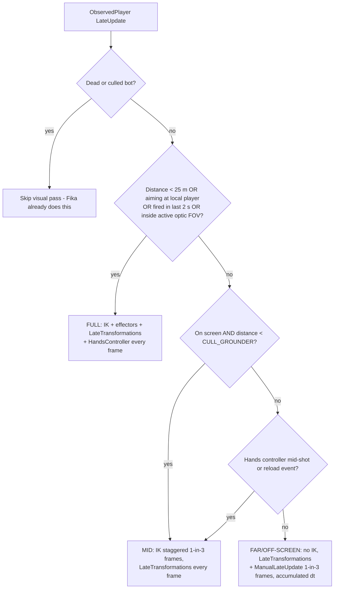
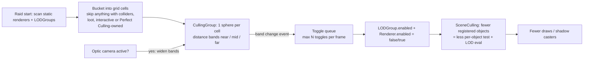
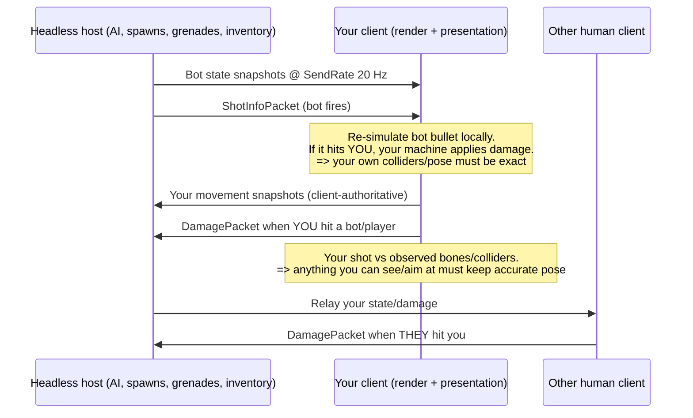
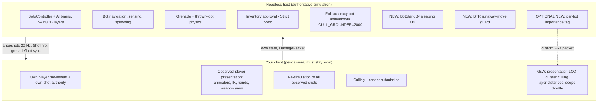

# Target observed players and culling, not AI

On a Fika client with a headless host, the largest remaining main-thread costs in EFT 0.16.9 are **drawing the ~19 observed players** (arms, IK, hands controllers and animators, about 1.5 ms combined) and **built-in scene culling** (about 1.15 ms). Bot AI already runs on the host, so AI work is not a client cost. The best feasible runtime mods are therefore a distance- and visibility-based level of detail (LOD) system for observed players, and switching distant static renderers and LODGroups off in clusters (`Renderer.enabled=false`). These build on two levers you have already proven: shadow-proxy culling and faded-light culling. The cheaper engine knobs follow them: per-layer cull distances, shadow cascades and distances, and throttling the scope camera. Several commonly suggested techniques do not apply to this build at all. These are BatchRendererGroup, the SRP Batcher, native graphics jobs on DX11, rebaking occlusion at runtime, Burst without a matching runtime, and update managers. Fika constrains the design in one way that matters. The shooter decides hits on human players, and the victim's machine decides hits from bots. So any client-side trick must keep the poses and colliders of anything that you can see, or that can hit you, at full accuracy. Visual-only throttling of things off-screen or far away is safe. Changing colliders or AI timing on a client is not. The headless already handles AI, spawning, grenade and loot physics. The only real further offloads are turning on EFT's bot sleeping on the headless, moving the BTR fix to the host, and an optional custom "bot importance" packet. Animation, IK and shot re-simulation have to stay on the viewing client. Altogether, the recommended client work can plausibly take 1.0–2.0 ms off the 7.1 ms main thread. That figure is an estimate built from your own component timings, not a measured result. Switching from exclusive fullscreen to borderless remains the largest single win, because it removes the measured ~4 ms present wait.

## The 7.1 ms frame is now presentation and culling

The headless host moved bot AI off the client. That saved 1.4–2.0 ms per frame and raised 1% lows from 61 to 86 fps. The remaining frame no longer looks like the self-hosted "AI is everything" profile that the SPT wiki describes, where **"the game uses the same CPU thread for bot processing and rendering"** ([SPT wiki](https://github.com/sp-tarkov/wiki/blob/main/Performance_Tuning.md)). Of the 7.1 ms main thread that remains, rendering takes 3.1 ms, scripts 1.7–1.9 ms, LateUpdate 0.95 ms and animation 0.75 ms. The render thread (4–5 ms) and GPU (5–6 ms) both have headroom, so CPU work is the limit. Moving cost from the main thread to the render thread or GPU is acceptable, but adding GPU work to save CPU only pays where the GPU has slack.

```
Client main thread, Streets, headless host (~7.1 ms ≈ 141 fps ceiling)
0 ms        1         2         3         4         5         6         7
|-----------|---------|---------|---------|---------|---------|---------|-
[Cull 1.15 ][Cam render 1.4 ][Fin .55][Update scripts 1.8 (Arms .8)][LateUpd .95][Anim .75][other ~.5]
 ^^^^^^^^^^  ^^^^^^^^^^^^^^^                        ^^^^^^^^^^^^^   ^^^^^^^^^^^   ^^^^^^^^^
 T2/T3:       T3: layer cull dist,                  T1: observed-   T1: visual    T1/T4: off-
 cluster      cascades, scope cam                   player hands/   pass, IK,     screen/far
 disable      throttle                              arms LOD        weapon anim   anim LOD

Reference budgets:  8.33 ms = 120 fps | 6.94 ms = 144 fps | 6.06 ms = 165 fps
Render thread 4-5 ms and GPU 5-6 ms: headroom (not the limiter)
Exclusive fullscreen: +~4 ms present wait -> use borderless (no mod needed)
```

The figures under each segment are the parts each recommended technique (T1–T4) targets. Two background facts shape the rest of this report. First, BSG's own later fixes went after the same costs. Patch 1.0.4.x added an "updated player culling system" map by map ([patched.gg 1.0.4.0](https://patched.gg/games/escape-from-tarkov/patch-1040)), and 1.0.5.0 optimized the animation system to lower CPU use ([Fandom changelog](https://escapefromtarkov.fandom.com/wiki/Changelog)). None of that is in 0.16.9, so a mod has to supply the equivalent. Second, Rust's developers found that visible-player costs ("LOD selection, animators, state machines, skinning") reached **"upwards of 10 ms"** on busy servers. Their culling rules recovered **20–30% performance** ([Rust Devblog 122](https://rust.facepunch.com/news/devblog-122)). EFT's observed-player cost is the same kind of cost, at a smaller scale.

## Ranked techniques: what fits a BepInEx/Harmony mod on this build

The table ranks each candidate by expected main-thread benefit, with feasibility and risk considered too. Benefit figures are estimates based on your component timings and the cited mechanisms. None of them has been measured as a delta.

| Rank | Technique | Targets | Est. main-thread gain | Feasibility | Fika compatibility |
|---|---|---|---|---|---|
| 1 | Observed-player presentation LOD: lower `CULL_GROUNDER`/`AnimatorCullDistance`, gate far `LateTransformations`/`HandsController.ManualLateUpdate`, stagger the visual pass over 3 frames | ArmsUpdate 0.8, LateUpdate 0.95 | 0.3–0.6 ms | High (Harmony prefixes on Fika `ObservedPlayer`) | Client-only, visual. Keep full rate for anything visible in an optic, close, or aiming at you |
| 2 | Cluster-based distance disabling of static renderers and whole LODGroups (CullingGroup bands, `enabled=false`) | Culling 1.15, render 1.4 | 0.2–0.5 ms | Medium-high | Client-only. Renderer-only; never colliders |
| 3 | Make the parked half-rate animation client-only for observed bots, with root motion off for puppets | Animation 0.75 | 0.3–0.5 ms on client | Medium | Client-only. Never humans, never on the host |
| 4 | `Camera.layerCullDistances` + `layerCullSpherical`, sun `layerShadowCullDistances`, cascades 4→2 | Render 1.4, shadow draws | 0.1–0.3 ms (more on render thread) | High (public API) | Client-only, visual |
| 5 | Scope/optic camera throttling: cullingMask, far clip, layer distances, render rate | Scoped spikes (~one extra cull pass) | Large while scoped, 0 otherwise | Medium | Client-only. Keep target-relevant layers |
| 6 | Combine far shadow-proxy cells with `Mesh.CombineMeshes` | Culling, shadow draws | 0.1–0.3 ms beyond current proxy culling | Medium-low (needs readable meshes) | Client-only |
| 7 | Script hygiene: `Physics.autoSyncTransforms`, `SkinnedMeshRenderer.updateWhenOffscreen`, check-before-set transforms, allocation-free hot patches | Update/LateUpdate | 0.05–0.2 ms | High | Safe if results are bit-identical |
| 8 | `QualitySettings.pixelLightCount`, realtime reflection-probe refresh/culling mask, `skinWeights` | Draws, probe re-renders | Small, map-dependent | High | Client-only |
| — | Not feasible or not worth it: BRG, SRP Batcher, native/split gfx jobs on DX11, runtime occlusion rebake, impostors, Burst without shipped runtime, update managers | — | — | Blocked | — |

### Observed-player presentation LOD is the top client win

Fika's source shows why `Player.ArmsUpdate` still costs about 0.8 ms on a client even though no AI runs there. Every remote human and bot is a full `ObservedPlayer`. It has a third-person animator, procedural weapon animation, FBBIK and limb IK, and a real hands controller, because every client **re-simulates every observed shot locally** through `InitiateShot` ([ObservedFirearmController.cs](https://github.com/project-fika/Fika-Plugin/blob/main/Fika.Core/Main/ObservedClasses/HandsControllers/ObservedFirearmController.cs)). Inside `ObservedVisualPass`, only the IK and effector block is gated by distance (`EFTHardSettings.CULL_GROUNDER`). `ProceduralWeaponAnimation.LateTransformations` and `HandsController.ManualLateUpdate` run **whenever arms were updated, with no distance check** ([ObservedPlayer.cs](https://github.com/project-fika/Fika-Plugin/blob/main/Fika.Core/Main/Players/ObservedPlayer.cs)). Three facts make this the top lever:

- Fika's `botPlayerCulling` is disabled for human profiles, so **human players are never culled at all** (same source).
- Fika 2.4.4 later added a 3-frame IK stagger and an "IK Cull Distance" setting (default 40 m), which writes `CULL_GROUNDER` ([v2.4.4 release](https://github.com/project-fika/Fika-Plugin/releases/tag/v2.4.4); [FikaConfig.cs](https://github.com/project-fika/Fika-Plugin/blob/main/Fika.Core/FikaConfig.cs)).
- Your 2.3.9 install has neither of those changes ([Fika-Plugin releases](https://github.com/project-fika/Fika-Plugin/releases)).

A client mod can backport both changes and go one step further by gating the far-player weapon late transforms. The design template is Rust's rule set: disable beyond a distance and behind the camera, force-enable inside a minimum distance, and force-enable when either side is aiming at the other. Facepunch added that last rule after players popped in and out during fights ([Rust Devblog 122](https://rust.facepunch.com/news/devblog-122)). Rust also "warmed" animators so they snap to the correct pose when re-enabled ([Changelist 2672](https://rust.facepunch.com/changelist/2672)). Fika's own config text spells out the visual cost: beyond the cull distance, "their arms won't update (floating gun)".



Your hit authority is the line this design must not cross. Fika's notes say that bones going stale on an off-screen bot does not matter, because you are not shooting at it. Bots in your peripheral or optic view must stay at full rate, though, because **you are the authority for your own shots** ([ObservedClientBridge.cs](https://github.com/project-fika/Fika-Plugin/blob/main/Fika.Core/Main/ObservedClasses/PlayerBridge/ObservedClientBridge.cs)). Visible humans are the more conservative case. For them, only the IK stagger and a lower `CULL_GROUNDER` make sense. Skipping the hands controller is risky when it consumes shot events. The patch must keep firing-event handling every frame and throttle only the pose and transform work. Whether `ManualLateUpdate` mixes the two is the main uncertainty, and it needs a decompile check before shipping.

### Cluster disabling extends your proven culling result

Your own measurement settles a question Unity does not document: `forceRenderingOff` does not reduce culling, but `enabled=false` does. That matches the documented purpose of `forceRenderingOff`, which only excludes the renderer from rendering ([Unity ScriptRef](https://docs.unity.cn/ja/ScriptReference/Renderer-forceRenderingOff.html)). It also matches a profiler hierarchy in which the main thread waits on `SceneCulling` jobs ([Unity forum](https://forum.unity.com/threads/culling-kills-performance.340777/)). Culling cost grows with the number of registered, enabled renderers and LODGroups. A shorter far clip changed almost nothing, so the cost is the per-object test itself. Unity's LODGroup docs point the same way: for forcing levels across many groups over many frames, **disabling the LODGroup and its renderers "might provide better CPU performance"** than LOD control ([LODGroup.ForceLOD](https://docs.unity3d.com/ScriptReference/LODGroup.ForceLOD.html)). The next step after shadow proxies and lights is a CullingGroup driven by distance bands. It would toggle whole clusters (grid cells of LODGroups and props) rather than single renderers. CullingGroup fires `onStateChanged` only when a sphere changes band, and it computes results during the camera's culling pass ([Unity Manual: CullingGroup](https://docs.unity3d.com/2019.3/Documentation/Manual/CullingGroupAPI.html)).



Three constraints follow from the notes:

- **Perfect Culling.** EFT ships Perfect Culling, which also toggles renderer enabled state when the camera crosses baked cells ([Perfect Culling thread](https://discussions.unity.com/t/released-perfect-culling-pixel-perfect-occlusion-culling/837404)). A mod must AND its visibility with Perfect Culling's, not fight it.
- **Shadows.** Disabling a renderer also removes its shadow, so the near band must keep shadow casters.
- **Toggle bursts.** Toggle bursts when crossing bands cause hitches, so they have to be spread across frames.

If you want to cut shadow proxies further, `Mesh.CombineMeshes` per cell is the only lever that reduces both the number of renderers culled and the number of draws. It needs readable meshes, which is unverified for EFT assets ([Unity Manual: optimizing draw calls](https://docs.unity3d.com/2022.1/Documentation/Manual/optimizing-draw-calls.html)).

### Cheap engine knobs and the scope camera

`Camera.layerCullDistances` and `Light.layerShadowCullDistances` are public and can be set at runtime. The camera's layer distances also cap shadow casting, and the smaller of the two distances applies ([Unity ScriptRef](https://docs.unity3d.com/kr/6000.0/ScriptReference/Light-layerShadowCullDistances.html)). Subnautica: Below Zero's "Fabulous Optimization" mod uses exactly this API ([Nexus](https://www.nexusmods.com/subnauticabelowzero/mods/716)). Because the distance test still runs per renderer, the gain shows up mainly in draws and shadow casters, which is the render-thread side. Your LOD-bias test showed the same pattern: 0.11 ms on the main thread against 0.37 ms on the render thread. A user report says four shadow cascades **"easily triples the amount of draw calls"** with dense geometry ([Unity Discussions](https://discussions.unity.com/t/culling-objects-in-specific-shadow-cascades/593695)). Dropping to two cascades is a cheap experiment, at some cost to shadow resolution near the player.

The scope camera is a separate case. A second full-scene camera runs its own culling pass, and players say scopes render the scene twice ([EFT forum 0.15 notes](https://forum.escapefromtarkov.com/topic/182464-patch-notes-for-01500/)). Trimming that camera's cullingMask, far clip and layer distances attacks a spike your steady-state numbers do not capture. PerformanceImprovements' lower in-scope resolution shows the community already treats the scope as a hot spot ([Forge listing](https://forge.sp-tarkov.com/mod/1890/performance-improvements)).

### Script-side hygiene and what not to build

The Mono-side levers are small but safe. Unity documents that `Physics.autoSyncTransforms=true` adds a sync before every physics query ([Unity manual](https://docs.unity.com/en-us/engine/6000.3/manual/physics-section/physics-overview/physics-optimization/cpu/transform-sync.md)), and KSPCommunityFixes' OptimizedModuleRaycasts removed exactly that cost in Kerbal Space Program ([KSPCF README](https://github.com/KSPModdingLibs/KSPCommunityFixes)). Check EFT's runtime value first. If you turn the setting off, add an explicit `Physics.SyncTransforms()` before ballistics. The Fika headless already does this before every `Shot.CheckCollision` ([Shot_CheckCollision_Transpiler.cs](https://github.com/project-fika/Fika-Headless/blob/main/Fika.Headless/Patches/PhysicsPatches/Shot_CheckCollision_Transpiler.cs)). Turning off `updateWhenOffscreen` on skinned meshes stops off-screen skinning ([Unity Manual](https://docs.unity3d.com/2022.3/Documentation/Manual/class-SkinnedMeshRenderer.html)). The KSPCommunityFixes model shows how these small fixes add up: dozens of narrow, toggleable patches gave **+32–86% average FPS** ([KSPCF README](https://github.com/KSPModdingLibs/KSPCommunityFixes)). Harmony itself carries costs and quirks. Inlined methods silently ignore patches, and generic methods are shared across reference types ([Harmony docs](https://harmony.pardeike.net/articles/patching-edgecases.html)). Patch the per-player outer method, not tiny helpers.

Several popular ideas do not work on this build. BatchRendererGroup lists **"Built-in Render Pipeline: No"** ([Unity Manual 2022.3 BRG](https://docs.unity3d.com/Manual/batch-renderer-group.html)), and the SRP Batcher needs an SRP. On DX11, Unity supports only legacy jobified graphics jobs. Native and split graphics jobs are DX12-only, and split jobs were not backported to 2022.3 ([Unity Discussions](https://discussions.unity.com/t/directx12-and-graphics-jobs-improvements-in-2023-1-split-graphics-jobs-and-editor-support/903434)). The SPT wiki also says boot.config edits give no performance gain ([SPT wiki](https://github.com/sp-tarkov/wiki/blob/main/Performance_Tuning.md)). Update managers save dispatch overhead, which Unity's blog measured as dominant only when Update bodies are tiny ([Unity blog](https://unity.com/blog/engine-platform/10000-update-calls)). At about 42 µs per observed player, EFT's cost sits in the method bodies. Burst can be loaded by mods through `BurstRuntime.LoadAdditionalLibrary` ([Burst modding docs](https://docs.unity3d.com/Packages/com.unity.burst@1.8/manual/modding-support.html)), but only if EFT ships a matching Burst runtime, which is unverified. Rust's experience with custom CPU occlusion is a further warning: its CPU cost could outweigh the GPU benefit ([Rust Performance Update](https://rust.facepunch.com/blog/the-performance-update)).

## Fika's authority model decides what is safe on clients

Fika is a client↔host↔client UDP model ([Fika wiki](https://github.com/project-fika/gitbook-wiki/blob/main/General-information.md)). Authority is spread across the machines, and every technique above has to respect that split. Bot AI exists only on the host: `HostGameController` owns the `BotsController`, while clients build bots with a null `BotOwner` ([HostGameController.cs](https://github.com/project-fika/Fika-Plugin/blob/main/Fika.Core/Main/GameMode/HostGameController.cs); [CoopHandler.cs](https://github.com/project-fika/Fika-Plugin/blob/main/Fika.Core/Main/Components/CoopHandler.cs)). Damage authority is split two ways. When a human shoots another player, **the shooter's machine computes armor and damage and sends a `DamagePacket`** ([ObservedPlayer.cs](https://github.com/project-fika/Fika-Plugin/blob/main/Fika.Core/Main/Players/ObservedPlayer.cs)). When a bot shoots the local player, **the victim's machine resolves the hit** ([FikaPlayer.cs](https://github.com/project-fika/Fika-Plugin/blob/main/Fika.Core/Main/Players/FikaPlayer.cs)). The host simulates grenades and resolves inventory actions when Strict Inventory Sync is on ([FikaClientGrenade.cs](https://github.com/project-fika/Fika-Plugin/blob/main/Fika.Core/Main/ClientClasses/FikaClientGrenade.cs); [v2.3.5 notes](https://github.com/project-fika/Fika-Plugin/releases/tag/v2.3.5)).



This leads to three rules. **Visual-only changes are safe on clients.** That covers renderer toggles, layer distances, shadows, and animation or IK LOD for things you cannot currently shoot at. **Collider changes are unsafe.** Because bullets are simulated locally and the shooter decides the hit, removing a collider on your client lets you shoot through objects that are solid for everyone else. That explains why the wiki tells users not to run DeClutter-type mods on the headless ([Wiki: Local Headless](https://github.com/project-fika/gitbook-wiki/blob/main/advanced-features/headless-client/local-headless-client.md)). **AI timing patches do nothing on clients**, because no `BotOwner` exists there. They belong only on the host.

Mod validation adds a deployment rule. Fika posts each plugin's GUID and a CRC32C hash of its DLL to `/fika/client/check/mods`. If `mods.required` and `mods.optional` are both empty, all mods are allowed. Otherwise an unlisted mod is Forbidden, and a hash that differs from the first client's is a HashMismatch, which quits the game ([FikaModHandler.cs](https://github.com/project-fika/Fika-Plugin/blob/main/Fika.Core/Main/Utils/FikaModHandler.cs); [ClientService.cs](https://github.com/project-fika/Fika-Server-CSharp/blob/main/FikaServer/Services/ClientService.cs)). Ship the optimizer under one stable GUID in `optional`, and make sure every client that uses it has the same build.

Fika also explains your parked half-rate animation result. On a client, an observed bot's position is written from interpolated snapshots in `ManualStateUpdate` ([ObservedPlayer.cs](https://github.com/project-fika/Fika-Plugin/blob/main/Fika.Core/Main/Players/ObservedPlayer.cs)), not produced by its animator's root motion. The ~20% movement shortfall must therefore come from somewhere that root motion still drives the transform: a self-hosted session, where bots are real `FikaBot`s, or an observed puppet whose root motion competes with the snapshot position. This is an inference. If it holds, the experiment can be revived safely on Fika clients alone. Set `applyRootMotion=false` (or intercept `OnAnimatorMove`) on observed bots that are being throttled, let the snapshots own position, and never throttle on the host. Unity's docs confirm that root motion adds the computed displacement to the GameObject's transform ([dtf.ru animation write-up](https://dtf.ru/gamedev/1070001-unity-performance-optimization-iii-animation-module)), and that `CullUpdateTransforms` keeps the state machine running while skipping IK and transform writes when invisible ([Unity AnimatorCullingMode](https://docs.unity3d.com/ScriptReference/AnimatorCullingMode.html)).

## The headless already took the movable work

The headless is not a true `-nographics` server. It is a full EFT client that hosts every raid and strips graphics: post-processing, grass, decals, water and audio are removed, and it renders at 1024x768 ([FikaHeadlessPlugin.cs](https://github.com/project-fika/Fika-Headless/blob/main/Fika.Headless/FikaHeadlessPlugin.cs); [SettingsPatch.cs](https://github.com/project-fika/Fika-Headless/blob/main/Fika.Headless/Patches/SettingsPatch.cs)). It deliberately sets `CULL_GROUNDER` and `AnimatorCullDistance` to 2000 so bot aim and hitboxes use accurate bones. It must stay **above 30 FPS**, or AI behaves strangely and grenades teleport ([Wiki: Headless FAQ](https://github.com/project-fika/gitbook-wiki/blob/main/faqandguides/headless-client-faq-and-common-issues/README.md)). The wiki puts separate-PC gains at **"usually around 25% to 50%"** ([Wiki: Headless Client](https://github.com/project-fika/gitbook-wiki/blob/main/advanced-features/headless-client/README.md)), which fits your measured 61→86 fps lift in 1% lows.



Three further offloads are realistic. First, the headless config ships `Bot sleeping` set to **false**, which disables EFT's `BotStandBy` ([FikaHeadlessPlugin.cs](https://github.com/project-fika/Fika-Headless/blob/main/Fika.Headless/FikaHeadlessPlugin.cs)). Fika for SPT 4.0 dropped its old "Dynamic AI" feature ([Fika-Documentation 3.x README](https://github.com/Jabaay/Fika-Documentation/blob/main/README.md)), so turning sleeping on is the built-in way to cut host AI load. It helps the client only indirectly: fewer moving bots means fewer snapshots and fewer shots to re-simulate. Second, the BTR runaway-move guard addresses a host-side bot. On a client it only patches a puppet, so it belongs on the headless as a separately toggled feature, even though the wiki otherwise says to keep performance mods off the headless. Third, the host already knows which bots are asleep, far away or out of combat. A custom host→client "importance" packet sent through Fika's API could feed rank 1 and rank 3 above. It needs the mod on both sides and should be throttled the way Fika's modding guide asks ([Wiki: Modding Fika](https://github.com/project-fika/gitbook-wiki/blob/main/Modding-Fika.md)).

The hard limits come from latency, authority and bandwidth. Animation and IK have to be evaluated at render rate on the viewer's machine, and the shooter's hit decision needs local bone poses. Streaming bone poses for about 20 players at 20 Hz would dwarf today's state snapshots. Even a Vector3 packet already costs 42 bytes on the wire (same wiki). Bullet re-simulation also stays local, because your client decides bot hits on you. The safe trim is to play only impact effects for distant bot-vs-bot shots whose path never passes near the local player. Valheim's networking mods show what happens otherwise: distance throttling becomes visible to nearby players, and moving more work to server authority broke raids ([FiresGhettoNetworking](https://thunderstore.io/c/valheim/p/VerdantsAscent/FiresGhettoNetworking/v/1.3.10/)). Keep anything in combat range at full fidelity.

## Conclusion

The headless changed what limits the client. Without AI on the main thread, the client's limit is how many characters it presents and how many objects it registers for culling. Neither cost is visible in Fika's settings in 2.3.9, and BSG only addressed both in the 1.0 series. The most useful features in this mod are therefore not novel engine tricks. They backport fixes that already exist upstream: Fika 2.4.4's IK stagger and cull distance, and BSG's later player culling and animation optimizations. On top of that come Rust-style safety rules and your own finding that disabling a renderer, not hiding it, is what removes it from culling. Updating to SPT 4.1 would deliver part of rank 1 for free, so weigh the porting effort against a version upgrade.

The constraint that matters most for design is Fika's split hit authority, not performance headroom. The same rule both allows and limits every client optimization: throttle presentation freely for what cannot hurt you, and never change what your client measures when it shoots or is shot. Treat the gain estimates here as hypotheses. Each rank should ship behind its own toggle, Performance Fish style ([Performance Fish](https://github.com/bbradson/Performance-Fish)), and be validated with the same Streets frame-time captures that produced your baseline.
